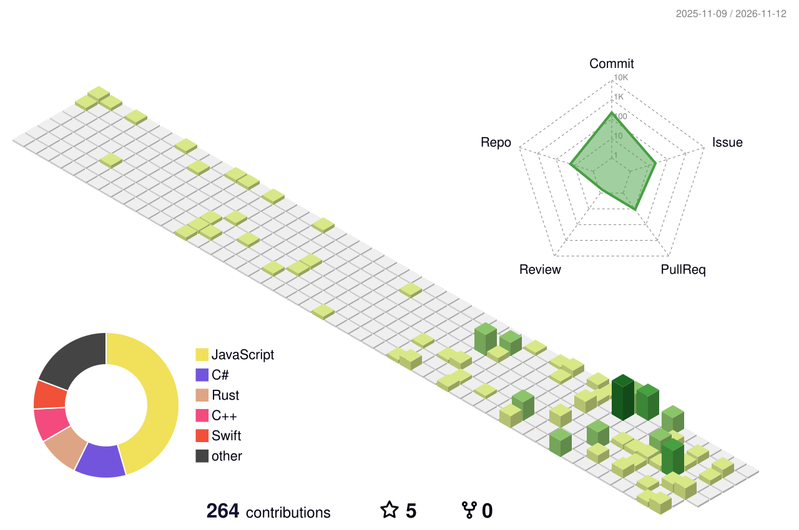

# Hi, I'm FengXi! 👋

**Student · Developer · Open Source Enthusiast**

I'm a student passionate about software development, networking, and exploring how technology works.

I enjoy building practical tools, experimenting with new ideas, and turning interesting problems into real projects.

### About Me

- 🎓 Wuhan University of Science and Technology student
- 🍎 Exploring **Swift, SwiftUI, and Apple platform development**
- 💻 Interested in **systems programming and cross-platform development**
- 🌐 Enthusiastic about **networking, servers, and infrastructure**
- 🚀 Building things for fun and learning along the way

### Tech Stack

**Languages**

**Tools & Platforms**

### Featured Projects

**[ListFXFlow](https://github.com/xiaoka520/ListFXFlow)**

A cross-platform keyboard and mouse sharing tool for macOS and Windows over Thunderbolt networking, featuring seamless cursor switching and cross-device clipboard synchronization.

**[WUSTFoundation](https://github.com/xiaoka520/WUSTFoundation)**

A Swift package providing authentication, session management, and campus service integration for WUST.

### GitHub Activity

### What I'm Exploring

- Native applications for Apple platforms
- Open-source development

---

*Learning by building.*
